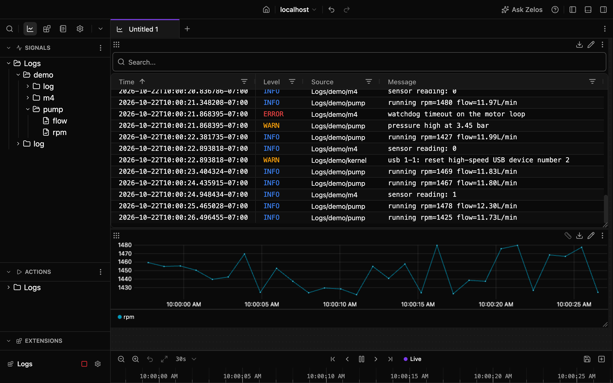

# Logs

Record the logs of your Linux boards in Zelos, on the same timeline as everything else you measure: the journal or syslog over SSH, any log file, or the output of any command.

- 🔌 **Just a host name**: if `ssh` reaches the board, so does Logs. Nothing to install.
- ⏱️ **The board's clock**: rows line up with your data, even if it reads 1970.
- 🧭 **The right level**: a service's `[warning]` is a warning, not the journal's info.
- 🔎 **Every line, searchable**: by level, by program and by message.
- 📈 **Values as signals**: `rpm=1450` in a line can plot as `rpm`.
- 🔁 **Picks up where it stopped**: the journal resumes after a drop or a reboot.
- 🗂️ **Any log**: a file, a command's output, or a saved log to convert or replay.

[](assets/readme/quickstart.mp4)

## Works with

| | |
|---|---|
| **Linux boards** | Any board `ssh` reaches: the journal (`journalctl`), else BusyBox or OpenWrt `logread`, else `/var/log/messages` or `/var/log/syslog` |
| **This computer** | Its system log: the journal or syslog on Linux, the unified log on macOS, the event log on Windows |
| **Files and commands** | Any file, followed through rotation, and any command that prints lines, such as `dmesg -w`, `adb logcat` or `docker logs -f`, on a board or on this computer |
| **Saved logs** | Plain, gzip, bzip2, xz or zstd log files |
| **Log formats** | The journal, syslog, the Linux kernel, Android logcat, and common logging libraries for C and C++, Rust, Go, Python and Java. [zelos-log-lines](https://pypi.org/project/zelos-log-lines/) lists every format. |

Logs runs on Linux, macOS and Windows, with Zelos 26.0.9 or later.

## Get started

1. Install **Logs** from Extensions and open its settings.
2. Set **Host** to a board, such as `me@my-board`, or pick one from your SSH config.
3. Press **Save & Start**. The board's log appears under **Logs** in the signal tree. Drag its `log` onto the layout to read it in a Log panel.



- **If `ssh me@my-board` works** in a terminal on this computer, it works here. **Test Connection** says what a host will be read from, or what to fix.
- **No access yet?** Run **Show Access Key** and paste its line into any shell on the board, even a serial console.
- **Log in as a user of your own, not root**, and add it to `systemd-journal` to read the whole journal. Run Command and command sources run as that user.
- **No board?** Set **Connection** to **Demo device**: a small controller whose pump logs its speed and flow, and which restarts every 90 s with its clock at 1970.

## Actions

Actions show up under **Logs** in the sidebar's **Actions**. Double-click one to add it to the layout.

- **Test Connection** connects to a host and says what it will read, or what to fix.
- **Show Access Key** gives the line that lets this computer into a board.
- **Run Command** runs a shell command on a source's host and returns its output.
- **Sample** returns a source's last lines, and **Get State** its counters and health.
- **Convert Log File** converts a saved log to a Zelos trace (`.trz`), even while Logs is stopped.

## When something is wrong

| You see | Do this |
|---|---|
| `<host> refused the login` | Run **Show Access Key** and paste its line into a shell on the board, or set **Key file**. |
| `The host key of <host> changed` | A reflashed board gets a new key. Run the `ssh-keygen -R` line the message gives, or set **Host key check** to **Trust any key**. |
| `<user> is not root and not in systemd-journal` | The journal shows that user only its own entries. On the board, run `sudo usermod -aG systemd-journal <user>`. |
| `<host> did not answer` | Check that the board is on and reachable from this computer. Logs keeps trying, up to once a minute. |
| `No log found` | The board keeps no system log Logs reads. Set **Read** to **File** or **Command output** instead. |

## From a script

The same actions run from Python or the command line:

```python
from zelos_sdk import connect

with connect() as agent:
    result = agent.actions.execute("Logs/sample", {"source": "bench-1", "lines": 20})
    print(result.value)
```

```bash
zelos actions execute Logs/convert_log_file --params '{"input_file": "/data/bench-1/syslog.2.gz"}'
```

## Reference

Every event and signal, how a board and a saved file are read, every setting, every action and every health message are in [docs/reference.md](docs/reference.md).

## Development

See [CONTRIBUTING.md](CONTRIBUTING.md).

## License

[MIT](LICENSE)
