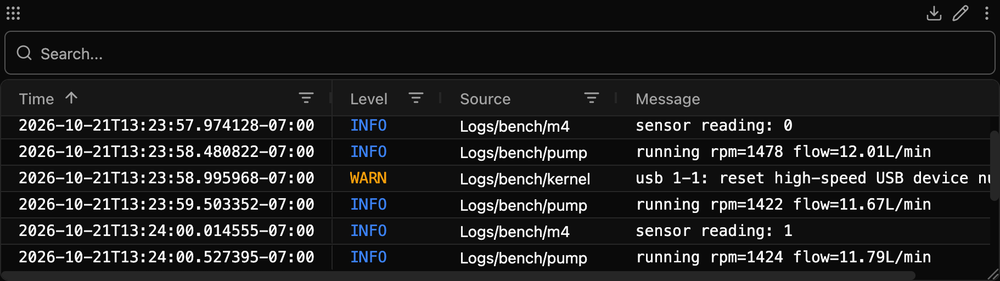

# Logs

Record the logs of Linux boards in Zelos, next to every other signal: the journal or syslog over SSH, a log file, or the output of any command.

- 🔌 **Just a host name**: Logs connects with your own `ssh`, asks the board what it keeps, and follows it: the journal, BusyBox or OpenWrt syslog, or a syslog file.
- 🔎 **Every line, searchable**: each row keeps its level, the program that printed it, and its message, with the logger's own stamp and level moved to their columns.
- 🧭 **The right level**: a service's spdlog `[warning]` is a warning, even though the journal stores all of a service's output as info.
- ⏱️ **The board's clock**: rows are placed by the board's monotonic clock, so a board that boots at 1970 still lines up with your CAN data.
- 🔁 **Picks up where it stopped**: after a dropped connection, a reboot or an agent restart, the journal resumes at the last position Logs saved.
- 🧰 **Any command**: `dmesg -w`, `adb logcat`, `docker logs -f`, `kubectl logs -f` or a test script, on a board or on this computer.



## What it reads

| | |
|---|---|
| **Connections** | SSH with your system's `ssh` client and its config, this computer, and a built-in demo device |
| **System log** | The journal (`journalctl`), else BusyBox or OpenWrt `logread`, else `/var/log/messages` or `/var/log/syslog` |
| **Also** | Any file, followed through rotation, and any command that prints lines |
| **Saved files** | Plain, gzip, bzip2, xz or zstd log files, converted to a trace or replayed |
| **Log lines** | spdlog, glog, syslog, Python, Rust, Go, Java, ROS 2, logcat, logfmt, JSON lines, Zephyr, ESP-IDF and kernel lines, read by [zelos-log-lines](https://pypi.org/project/zelos-log-lines/) |
| **Runs on** | Linux, macOS and Windows, with Zelos 26.0.9 or later |

## Quick start

1. **Add a source**: set **Host** to `root@my-board`, or pick a Host from your SSH config in the list.
2. **Start** Logs. The board's journal appears in the Log panel, a row per entry.

If `ssh root@my-board` works in a terminal on the computer that runs the agent, it works here.
No access yet? Run **Show Access Key** and paste its install line into any shell on the board, even a serial console.
**Test Connection** says what a host will be read from, or what to fix.

No board? Set **Connection** to **Demo device**: a small controller whose pump service logs through spdlog, whose co-processor forwards its messages, and which restarts every 90 s with its clock at 1970. The pump's printed values, such as `rpm` and `flow`, become signals.

## What it records

All events go under one trace source, `Logs` by default (**Prefix** in Advanced (all sources)).
Each source has a name, set by **Name**. Without one, the name says where the source reads: the host made safe (`root@bench.local` becomes `bench_local`), `local` or `demo`, then the file's name or the command's program, such as `bench_local syslog` or `local adb`.

| Event | Holds |
|---|---|
| `Logs/<name>/log` | Every entry or line: its level, the program that printed it (`name`), its message, and the file and line when the program sent them. Also the extension's notes on the source, under the name `logs`, each starting with `[logs] `. |
| `Logs/<name>/<program>` | The values a program printed, when **Printed values as signals** is on. |
| `Logs/<name>/values` | The values printed in lines that name no program, when **Printed values as signals** is on. |
| `Logs/log` | The extension's own log. |

In the Log panel, the **Source** column names where each row came from. **Show Sources** turns it on.

## How it reads a board

### The system log picks itself

Before every connection, Logs runs one short `sh` probe on the board. It finds:

1. **The journal**, when `journalctl` is installed: Logs follows `journalctl -f -o json`.
2. **BusyBox or OpenWrt syslog**, when `logread` works.
3. **A syslog file**, `/var/log/messages` or `/var/log/syslog`, followed with `tail -F`.

Each line of BusyBox and OpenWrt syslog carries its `facility.level`, so levels survive there too.

### Levels

A journal entry's level comes from the line's own header when it has one, such as spdlog's `[warning]` or Python's `WARNING:`.
Without one, it comes from the entry's priority, which `syslog()`, the journal API and spdlog's systemd sink set.
A word inside the sentence never sets a level: `High Level Software warning` is logged as info.

### Time

- **Journal entries** are placed by the board's monotonic clock, mapped onto this computer's clock for each boot. The probe reads the board's uptime, so history sent at connect lands at its own time. A board whose clock reads 1970 until its network sets it still lines up.
- **An entry from an earlier boot**, which a resume can bring, takes its wall-clock stamp, shifted by how far the board's clock was from this computer's.
- **Other lines** take the time they arrive, unless they carry a kernel-style uptime such as `[    1.234567]`.

Set **Time** to **When the line arrives** to place every row by arrival.

### History and resume

- **First start**: the journal sends the current boot, as far back as the agent keeps data: its data retention, or an hour before the board's clock when the agent does not say. With **History** set to **New lines only**, it starts at the next entry.
- **A dropped connection, a reboot or an agent restart**: the journal resumes at the last position Logs saved, so nothing the journal still holds is lost. Logs saves the position every 5 s and when it stops, so an extension that ends without stopping can record up to its last 5 s again. The position is kept in the extension's data directory, which updates keep. A position older than the agent keeps data is not resumed: the source starts with the history again.
- **logread, files and commands** start at new lines. After a drop, a note says how long the source was away.
- **A reboot** writes the note `[logs] device restarted`.

### Access

Logs runs your system's `ssh` with `BatchMode`, so it never asks for a password. It honors your SSH config: `Host` aliases, `ProxyJump`, `IdentityFile`, `IdentityAgent` and `Include`.

- **Show Access Key** makes a key for this computer, kept in the extension's data directory, and gives the line that adds it to a board. A headless agent uses it with no person's keys on the machine. `ssh` still offers your SSH agent's keys and your default keys too.
- **Key file** uses one private key and nothing else.
- **Host key check** trusts the board's key by default, because a reflashed board gets a new one. **Check known_hosts** refuses a key it does not know.
- **Extra ssh options** go first on the `ssh` command line, such as `-J bastion`.

A user that is not root and not in `systemd-journal` sees only its own journal entries. Logs says so, with the line that fixes it: `sudo usermod -aG systemd-journal <user>`.

## Saved log files

Logs reads a saved file as it reads a live log, and places each row at the time its line printed.
A file can be plain, or compressed with gzip, bzip2, xz or zstd.

### Convert to a trace

`convert` writes a Zelos trace (`.trz`) beside each file. It needs no agent.

```bash
uv run main.py convert app.log                    # writes app.trz
uv run main.py convert boot.log run.log.gz -f      # one trace for each file, overwriting
uv run main.py convert app.log -o bench-1.trz --zone Europe/Berlin --year 2025
```

- The trace's source is `Logs`, and the log is named after the file: `syslog.2.gz` becomes `Logs/syslog_2/log`. `--name` sets another name.
- `-o` names the trace, for one file only.
- `-f` overwrites a trace that exists. Without it, that file fails.
- Each file prints `<file> -> <trace> (N lines)`. A file that fails prints why, and the others still convert. The command exits with 1 when any file failed.

The **Convert Log File** action converts one file from the Action panel, a notebook or Zelos AI, also while the extension is stopped.

### Replay into the agent

```bash
uv run main.py replay app.log
```

`replay` writes the file's lines into the agent at the pace they were printed, the first one now. Ctrl-C stops it, and it prints how many lines it replayed.

A replay source does the same while the extension runs: on **This computer**, set **Read** to **A saved file, replayed**. It replays the file once, then ends. It replays again when the extension restarts.

### Where each row goes

- **A printed time** places the row.
- **A stamp with no time zone** is read in this computer's zone, unless you give one.
- **A stamp with no year, or no date,** takes it from the file's last change. Where the stamps wrap to a new year, or a new day, the rows before them step back a year, or a day.
- **A file that prints only uptime**, such as kernel lines, ends at the file's last change, unless you give its start. Each run after a restart follows the one before.
- **A line that prints no time** follows the line before it.

A gzip file's last change is the one gzip recorded, so a rotated log keeps its own.

Give the zone, the year and the start with `--zone`, `--year` and `--start` on the command line, or with **Time zone**, **Year** and **Start time** in the action and in a replay source's **Advanced**.
The year is the year of the last stamp that prints none. The start is an ISO 8601 time with its offset, such as `2026-10-21T14:03:01+02:00`.
A replay keeps the gaps between rows and moves them all so the first is now.

## Configuration

The config holds a list of `sources` and one `advanced` group.

| Field | Values | Default |
|---|---|---|
| **Connection** | `ssh` (SSH), `local` (This computer), `demo` (Demo device) | `ssh` |
| **Host** | `[user@]host` or a Host from your SSH config | required for SSH |
| **Read** | `system` (System log), `file` (A file), `command` (A command), `replay` (A saved file, replayed; this computer only) | `system` |
| **File** | The path to follow, or the saved file to replay | required for a file and a replay |
| **Command** | The command to run; over SSH it runs in `sh` on the host | required for a command |
| **Name** | Letters, digits, spaces, `_` and `-` | made from where it reads |

**Advanced** (each source): SSH port, Key file, Host key check, Extra ssh options, History (`kept` or `new`), Time (`device` or `arrival`), and Printed values as signals (`auto`, `on` or `off`).
`auto` turns values off for the system log, whose kernel and daemon lines would make signals of every `pid=`, and on for files, commands and replays.
A replay also has Time zone (`time_zone`), Year (`year`) and Start time (`start_time`), described in [Where each row goes](#where-each-row-goes).

**Advanced (all sources)**: Prefix (default `Logs`) and Log level.

The system log of **This computer** is read on Linux. On macOS and Windows, read a file or a command.

### Examples

```json
{ "sources": [{ "connection": "ssh", "host": "root@bench-1" }] }
```

```json
{ "sources": [{ "connection": "ssh", "host": "root@bench-1", "read": "file", "path": "/var/log/acme/run.log", "name": "bench-1 run" }] }
```

```json
{ "sources": [{ "connection": "local", "read": "command", "command": "adb logcat", "name": "tablet" }] }
```

```json
{ "sources": [{ "connection": "local", "read": "replay", "path": "/var/log/app.log.1", "advanced": { "time_zone": "Europe/Berlin" } }] }
```

## Actions

Every action except List Hosts, Auto-configure, Test Connection, Show Access Key and Convert Log File takes `source`, the source's **Name**. Leave it out to act on the first source.

| Action | What it does | Read-only |
|---|---|---|
| List Hosts | Lists the Hosts in this computer's SSH config, for the **Host** field. | yes |
| Auto-configure | Keeps the configured sources and adds this computer's system log on Linux, or the demo device when there is nothing else. | yes |
| Test Connection | Connects to a host, with a source's SSH port, Key file, Host key check and Extra ssh options, and says what it will read, or what to fix. | yes |
| Show Access Key | Returns this computer's key, made on first use, and the line that adds it to a board. | no |
| Convert Log File | Converts a saved log file to a trace (`.trz`), also while the extension is stopped. Takes `input_file`, `output_file`, `overwrite`, `time_zone`, `year` and `start_time`, and returns the trace and the lines read. | no |
| Run Command | Runs a shell command on a source's host and returns its output and exit code. | no |
| Get State | Returns a source's state, what it reads, its counters, its last message and the signals its values became. | yes |
| Sample | Returns the last lines a source recorded. | yes |

## Health

Each failure gives one sentence with the fix, in Get State and as a note in the source's log:

- the host cannot be resolved, refuses the connection, or does not answer;
- the board refused the login (run Show Access Key);
- the host key is unknown or changed;
- the board keeps no log Logs reads;
- the user sees only part of the journal;
- a file on this computer does not exist yet, or cannot be read;
- a command finished, so it does not run again until the extension restarts;
- a saved file cannot be read, so it is not replayed until the extension restarts.

A dropped connection is tried again after 1 s, then up to once a minute. A refused login is tried once a minute.

## Development

See [CONTRIBUTING.md](CONTRIBUTING.md).

## License

[MIT](LICENSE)
